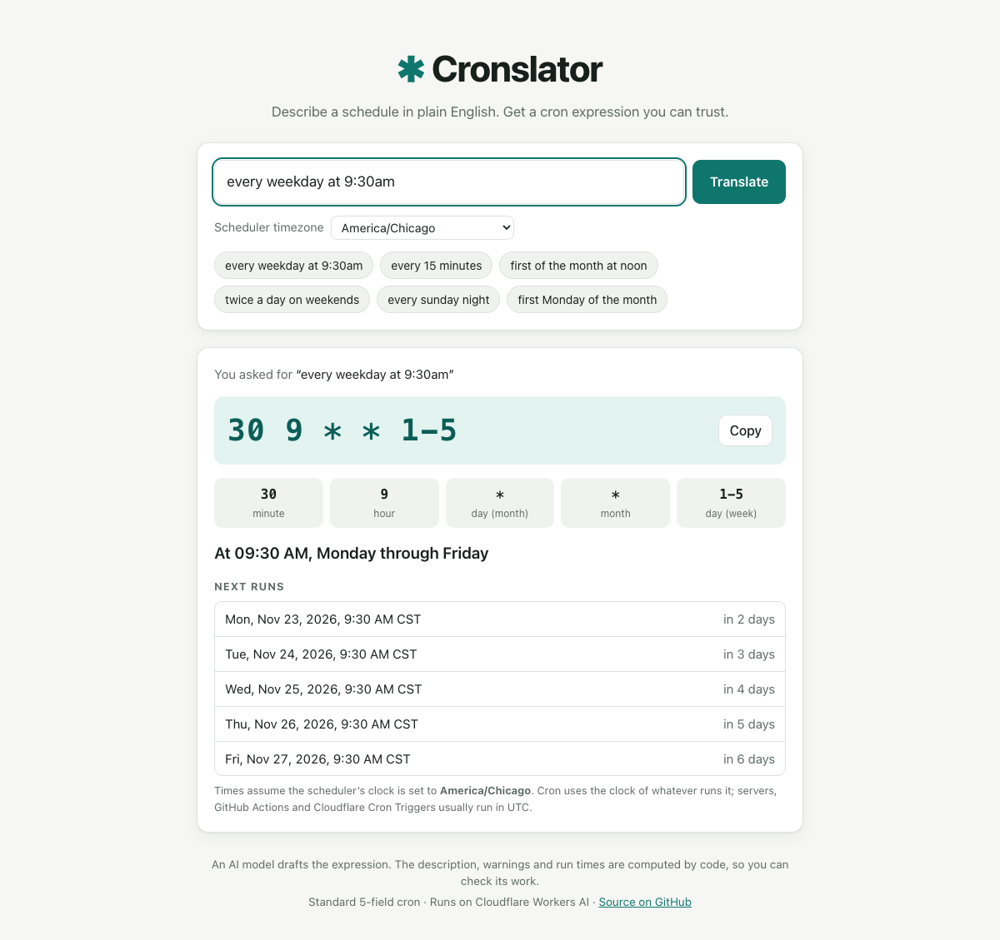
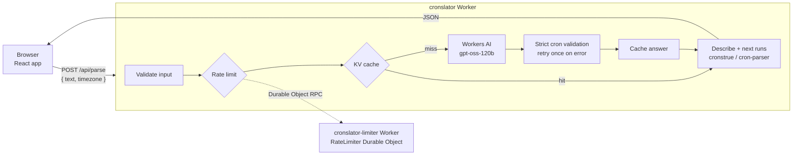

# ✱ Cronslator

**Describe a schedule in plain English. Get a cron expression you can trust.**

[](https://github.com/BobaFettyW4p/cronslator/actions/workflows/ci-cd.yml)

**Try it → [cronslator.ivancicm.workers.dev](https://cronslator.ivancicm.workers.dev)**



| You type | You get |
|---|---|
| every weekday at 9:30am | `30 9 * * 1-5` |
| every 15 minutes during business hours | `*/15 9-16 * * 1-5` |
| on the 1st and 15th of each month at noon | `0 12 1,15 * *` |
| every day except sunday at 7am | `0 7 * * 1-6` |
| the first Monday of the month | An explanation of why cron can't do that, plus a workaround |

---

## Why you can trust the output

Large language models are good at understanding "every other hour on weekdays". They're also good at writing cron that *looks* right and isn't. Cronslator uses the model for the part it's good at and checks everything else with ordinary code:

1. **An AI model drafts the expression.** It's [`gpt-oss-120b`](https://developers.cloudflare.com/workers-ai/models/) on Cloudflare Workers AI. Its output is constrained to a JSON schema and guided by examples of the classic traps.
2. **Code validates it strictly.** Only standard 5-field cron gets through: no seconds field, no `?`, `L`, `W`, `#` or `@daily`. These are the expressions that work in crontab, Kubernetes, GitHub Actions and Cloudflare Cron Triggers. If the draft is invalid, the model gets the error message and one more try.
3. **Code explains it.** The plain-English description ([cronstrue](https://github.com/bradymholt/cRonstrue)), the next five run times ([cron-parser](https://github.com/harrisiirak/cron-parser), timezone- and DST-aware) and the warnings are all computed from the expression itself. The model doesn't write them, so you can check its work.

It also tells you when cron **can't** do what you asked, instead of quietly handing you something close:

- **"Every 45 minutes":** `*/45` actually fires at :00 and :45, so the gaps alternate between 45 and 15 minutes.
- **"The first Monday of the month":** if both day-of-month and day-of-week are set, cron runs when *either* matches. `0 9 1-7 * 1` therefore runs on days 1–7 *and* every Monday.
- **"The last day of the month", "every 90 seconds", "every other week":** standard cron has no way to say these.

In those cases you get an explanation and a suggested workaround, and you can click the workaround to see exactly what it does.

## Accuracy

Accuracy is measured with a 64-case test set ([`test/eval/cases.ts`](test/eval/cases.ts)). It covers everyday schedules, vague phrasing ("every morning"), typos and 24-hour times, schedules cron can't express, and off-topic or prompt-injection input. Answers are scored by **meaning, not text**, so `*/30 * * * *` and `0,30 * * * *` both count as correct.

| Model | Accuracy | Median latency |
|---|---|---|
| `@cf/openai/gpt-oss-120b` | **100%** (128/128 over two runs) | 2.8s |

Repeat questions are cached, so they come back in milliseconds.

## How it works



- **One Worker** serves both the React app (Workers Static Assets) and the API. There's no CORS and no separate frontend host.
- **Rate limiting:**
  - **10 requests/minute per client** (IPv6 clients are grouped by `/64`) and **200/minute overall**.
  - Counted exactly by a Durable Object in a small private Worker, `cronslator-limiter`.
  - It's a separate Worker because Cloudflare doesn't create preview URLs for Workers that contain a Durable Object, and keeping it out of the app keeps PR previews working.
- **Caching:**
  - Model answers are stored in KV for 30 days.
  - The key is the model plus a fingerprint of the prompt plus a hash of the normalized question. Editing the prompt or switching models therefore starts a fresh cache automatically.
  - Only the model's answer is cached. Descriptions and run times are recomputed on every request.
- **Timezone changes** call `/api/describe`, which explains an expression without calling the model.

## API

Both endpoints return JSON. Failed requests return `{ "ok": false, "error": "<code>", "message": "<human-readable>" }`.

### `POST /api/parse`

Turns a plain-language schedule into cron.

```bash
curl -X POST https://cronslator.ivancicm.workers.dev/api/parse \
  -H 'content-type: application/json' \
  -d '{"text": "every weekday at 9:30am", "timezone": "America/Chicago"}'
```

```jsonc
{
  "ok": true,
  "input": "every weekday at 9:30am",
  "cron": "30 9 * * 1-5",
  "description": "At 09:30 AM, Monday through Friday",
  "fields": [{ "field": "minute", "value": "30" }, /* … */],
  "nextRuns": ["2026-11-23T15:30:00.000Z", /* 5 ISO timestamps */],
  "timezone": "America/Chicago",
  "warnings": [],
  "assumptions": "",
  "model": "@cf/openai/gpt-oss-120b"
}
```

`text` is required (200 characters max). `timezone` is an optional IANA name and defaults to `UTC`; it only affects `nextRuns`. The `x-cache: HIT|MISS` header shows whether the model was called.

| Status | `error` | Meaning |
|---|---|---|
| 400 | `bad_request` | Empty or too-long text, or an unknown timezone |
| 422 | `not_expressible` | Standard cron can't express it. `message` explains why and usually suggests a workaround |
| 429 | `rate_limited` | Too many requests; see `Retry-After` |
| 502 | `model_error` | The model failed twice |
| 503 | `over_capacity` | The daily AI quota is used up; see `Retry-After` |

### `GET /api/describe?cron=…&tz=…`

Validates and explains any standard cron expression. It never calls the model and isn't rate limited.

```bash
curl 'https://cronslator.ivancicm.workers.dev/api/describe?cron=0+*/6+*+*+*&tz=Europe/London'
```

It returns the same fields as `/api/parse`, except `input`, `assumptions` and `model`. Invalid expressions return `400` with the reason, e.g. `Non-standard characters (?, L, W, #, H) are not supported in 5-field cron`.

## Running it locally

You need **Node 22+** and a **Cloudflare account**. Workers AI only runs on Cloudflare, so even local development calls the real model.

```bash
git clone https://github.com/BobaFettyW4p/cronslator.git
cd cronslator
npm install
npx wrangler login     # needed for Workers AI in local dev
npm run dev            # http://localhost:5173
```

`npm run dev` runs the app Worker and the rate-limiter Worker together through the Cloudflare Vite plugin. KV and Durable Objects are simulated locally. Workers AI is remote, so **local requests use your account's Workers AI quota**.

### Tests

```bash
npm test             # 130+ unit and API tests, using a fake AI binding (free and repeatable)
npm run typecheck
npm run lint
```

### Accuracy eval

```bash
npm run eval                                    # full set against the configured model
npm run eval -- --tag hard                      # one category
npm run eval -- --model @cf/google/gemma-4-26b-a4b-it
npm run eval -- --repeat 3 --min 0.95           # consistency check; exit 1 below 95%
```

The eval runs the production `translate()` code directly through `getPlatformProxy`, with no cache and no rate limit. **Every case is a real model call.** On the Workers Free plan that comes out of the same 10,000-neuron daily allowance as your live site, so run subsets when you can. The eval stops cleanly if the quota runs out.

## Deployment

Every deploy goes through GitHub Actions ([`.github/workflows/ci-cd.yml`](.github/workflows/ci-cd.yml)):

| Trigger | What happens |
|---|---|
| Any PR or push | Typecheck, lint, test, build |
| Pull request | The app is uploaded as a preview version, and its URL is posted as a PR comment |
| Push to `main` | Deploys `cronslator-limiter`, then the app, to production |

To deploy your own copy:

1. Create a KV namespace with `npx wrangler kv namespace create CRON_CACHE`, and put its `id` in `wrangler.jsonc`.
2. Create a Cloudflare API token from the **Edit Cloudflare Workers** template, with **Workers AI: Read** added.
3. Add the repository secrets `CLOUDFLARE_API_TOKEN` and `CLOUDFLARE_ACCOUNT_ID`.
4. Push to `main`.

Before the first merge, PR previews fail because the `cronslator-limiter` Worker doesn't exist yet. Merging, or deploying the limiter once by hand, fixes this.

## Project layout

```
worker/            App Worker
  index.ts         Routes: /api/parse, /api/describe, /api/health
  llm.ts           Model call, response parsing, validate-and-retry loop
  prompt.ts        System prompt, JSON schema, few-shot examples
  cron.ts          Strict validation, description, next runs, warnings
  cache.ts         KV cache keys and read/write
  rateLimit.ts     Per-client and global limits, IPv6 /64 keys
limiter/           cronslator-limiter Worker (RateLimiter Durable Object)
shared/api.ts      Request/response types shared by the Worker and the app
src/               React app
test/              Vitest tests and the accuracy eval (test/eval)
```

## Limits

- **Standard 5-field cron only.** Quartz, AWS EventBridge and other 6–7 field dialects aren't supported.
- **Times aren't converted between timezones.** "9am" becomes hour 9 on whatever clock your scheduler uses, and the timezone picker only changes how the next run times are shown. Servers, GitHub Actions and Cloudflare Cron Triggers usually run in UTC.
- **There's a daily cap on new questions.** The live site runs on Cloudflare's free tier, which allows roughly 400 new questions a day. Cached questions don't count. When the allowance runs out, the site says so and recovers at 00:00 UTC.

## Built with

[Cloudflare Workers](https://developers.cloudflare.com/workers/) · [Workers AI](https://developers.cloudflare.com/workers-ai/) · [Durable Objects](https://developers.cloudflare.com/durable-objects/) · [Workers KV](https://developers.cloudflare.com/kv/) · [React](https://react.dev/) · [Vite](https://vite.dev/) · [cron-parser](https://github.com/harrisiirak/cron-parser) · [cronstrue](https://github.com/bradymholt/cRonstrue) · [Vitest](https://vitest.dev/)
